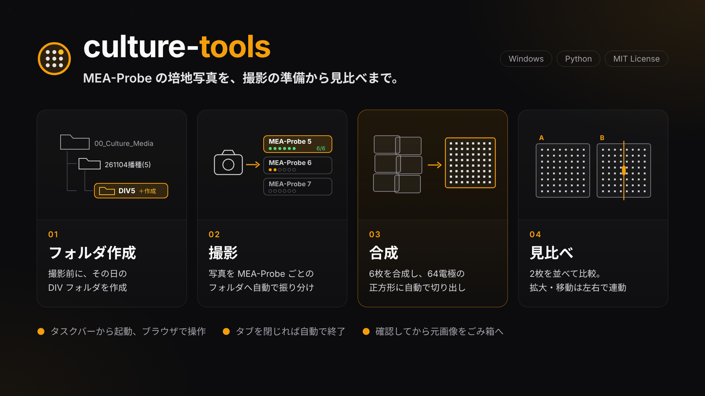

# culture-tools

MEA-Probe（Microelectrode Array Probe：微小電極アレイを備えた培養器）の培地写真を扱うツールです。撮影前のフォルダ作成、撮影した写真のMEA-Probeごとの振り分け、顕微鏡で6枚に分けて撮った写真の合成（1枚で撮るMEA-Probeは切り出しのみ）、合成画像の見比べを、1つの画面で行います。

8×8（64電極）のMEA-Probeを、倒立顕微鏡に取り付けたカメラで撮影する運用を前提にしています。電極の種類は2つに対応しています。

| 電極の種類 | 電極 | 撮影枚数 | 合成画像の作り方 |
| --- | --- | --- | --- |
| 545電極 | 一辺50 µm、電極間距離（中心間）450 µm | 6枚 | 6枚を合成し、正方形に切り出す |
| 515電極 | 545より密に並ぶ | 1枚 | 合成はせず、1枚から電極を検出して傾きを補正し、正方形に切り出す |

撮影機能は、Canon のカメラ用ソフト EOS Utility で写真をパソコンに保存する使い方を想定しています。Windows以外での動作は確認していません。

## 目次

- [概要](#概要)
- [初回の準備](#初回の準備)
- [起動と画面](#起動と画面)
- [撮影前のフォルダ作成](#撮影前のフォルダ作成)
- [撮影](#撮影)
- [合成](#合成)
- [見比べ](#見比べ)
- [困ったとき](#困ったとき)
- [仕様](#仕様)
- [ライセンス](#ライセンス)

## 概要

### 用語

| 用語 | 意味 |
| --- | --- |
| MEA-Probe | 細胞を播種する培養器1枚1枚。画面では「MEA-Probe 5」のように、Probe番号を付けて表示する |
| Probe番号 | MEA-Probeに振った番号。フォルダ名の括弧内の「Probe」に続く数字（例：`261028播種(Probe 6)` の6） |
| DIV | Days In Vitro（播種当日をDIV0とした経過日数） |
| 電極の種類 | MEA-Probeの電極の並び方。545電極と515電極がある。新しく播種したMEA-Probeのフォルダを作るときに選ぶ |
| 元画像 | 顕微鏡で撮影した写真（`IMG_0001.JPG` など）。545電極は6枚、515電極は1枚 |
| 追加の写真 | 元画像とは別に撮った写真（例えば、1つの電極を拡大した写真）。合成には使わない（例：`261109_5_extra1.JPG`） |
| 合成画像 | 元画像を合成し、64電極が収まる正方形に切り出した画像（例：`261104_6.jpg`）。515電極は1枚から切り出したもの |

### 作業の流れ

1. 撮影の前に、「フォルダ作成」でその日のDIVフォルダを作る
2. 「撮影」で撮影モードを始め、MEA-Probeごとに撮影する（545電極は6枚、515電極は1枚。写真は自動でDIVフォルダに移る）
3. 「合成」で「合成を開始」を押す
4. 続けて表示される結果で合成画像を確かめ、問題のないフォルダの元画像をごみ箱へ移す

合成画像は「見比べ」で、日付の異なる2枚の画像を並べて比較することができます。

### 置き場所

ツールは機能ごとにフォルダが分かれています。写真のフォルダ（`YYMMDD播種(Probe 番号)` のフォルダを入れる場所）とは別の場所に置いてください。写真のフォルダにはプログラムを置きません。

| フォルダ・ファイル | 中身 |
| --- | --- |
| `app` | アプリ本体（起動、画面の切り替え）。初回の準備のあと、実行環境（`.venv`）、写真のフォルダと取り込み元フォルダの設定（`config.json`）、MEA-Probeごとの電極の種類の記録（`probes.json`）、動作の記録（`app.log`）もここに作られる |
| `stitch` | 合成。合成結果の記録（`review`）もここに保存される |
| `viewer` | 見比べ。スケールバーの長さの記録（`scale_cache.json`）もここに作られる |
| `folders` | フォルダ作成 |
| `capture` | 撮影（写真の振り分け） |
| `タスクバー用のショートカットを作成.bat` | 初回の準備で1回だけ使う |
| `README.md` | この説明書 |
| `docs` | この説明書で使う画像（`overview.png`：上の概要図。写真は使わず、図で描いたもの） |
| `LICENSE` | ライセンス（MIT License） |

## 初回の準備

この章の作業は初回の1度だけ必要です。必要なものは、Pythonと、写真のフォルダ（`YYMMDD播種(Probe 番号)` のフォルダを入れる場所）です。写真のフォルダは、ローカルディスク内のフォルダでも、Googleドライブのデスクトップ版で見えているフォルダでも構いません。

1. **ダウンロードする**：GitHubのこのページの「Code」→「Download ZIP」でダウンロードして展開し、`culture-tools` フォルダを好きな場所（例：`Workspace`）に置きます。Gitを使う場合は `git clone` でも構いません。
2. **Pythonを確認する**：コマンドプロンプトで `py --version` と入力し、`Python 3.12` 以降が表示されれば問題ありません。表示されなければ [python.org](https://www.python.org/downloads/) からインストールします（インストール時の設定は既定のままで構いません）。
3. **`タスクバー用のショートカットを作成.bat` をダブルクリックする**：実行環境がまだなければ `app\.venv` に作られ（数分かかり、インターネット接続が必要）、スタートメニューに culture-tools のショートカットができます。
4. **タスクバーにピン留めする**：自動で開いたフォルダで culture-tools を右クリックし、「タスクバーにピン留めする」を選びます。Windows 11で見当たらない場合は、「その他のオプションを確認」の中にあります。
5. **写真のフォルダを選ぶ**：タスクバーから初めて起動すると、フォルダを選ぶ画面が出ます。写真のフォルダを選ぶと、その場所が `app\config.json` に保存され、次からは自動で使われます。

スタートメニューで「culture」と検索しても起動できます。

- **写真のフォルダを変えたいとき**：`app\config.json` を削除してから起動すると、選ぶ画面がもう一度出ます。保存した場所が見つからないときも、起動時に選び直すかどうかを聞かれます。
- **`culture-tools` フォルダを移動したり名前を変えたりしたとき**：古いピン留めを外してから、手順3と4をやり直します。
- **新しい版に入れ替えるとき**：`app\.venv`、`app\config.json`、`app\probes.json` はそのまま残し、ほかのファイルを新しいものに置き換えます。

## 起動と画面

タスクバーの culture-tools を押すと、ブラウザに画面が開きます。上部の「フォルダ作成」「撮影」「合成」「見比べ」で画面を切り替えます。

| 画面 | できること |
| --- | --- |
| フォルダ作成 | 撮影前にDIVフォルダを作る。新しく播種したMEA-Probeのフォルダも作る |
| 撮影 | 撮影中に届いた写真を、撮っているMEA-ProbeのDIVフォルダへ自動で移す。撮影モード中は「撮影」の横に ● が付く |
| 合成 | 合成待ちのフォルダをまとめて合成し、結果の確認と元画像の削除を行う。合成待ちがあるときは、「合成」の横にその数が表示される |
| 見比べ | 合成画像を2枚並べて比べる |

- 開いたときに合成待ちのフォルダがあれば「合成」から、なければ「フォルダ作成」から始まります。
- 使い終わったらタブを閉じるだけで、数秒後にアプリも終了します。合成の途中で閉じても、合成が終わるまでは終了しません。撮影モード中に閉じた場合は、撮影モードも終わります。タブを裏に回してほかの作業をしていても終了しません。
- 開いているときにもう一度タスクバーのアイコンを押すと、新しく起動せずに今の画面をもう一度開きます。
- アプリが終了したあとで古いタブに戻ると、「culture-tools は終了しています」と表示されます。タスクバーから開き直してください。
- 写真のフォルダが見つからないとき（Googleドライブが起動していないときなど）は、その旨が通知で表示されます。詳しい記録は `app\app.log` に残ります。

## 撮影前のフォルダ作成

1つのDIVフォルダには、そのMEA-Probe・その日の元画像（545電極は6枚、515電極は1枚）と、必要なら追加の写真を入れます。ツールはフォルダ名から播種日とProbe番号を、写真から撮影日を読み取ります。

### 「フォルダ作成」の使い方

1. 「フォルダ作成」に切り替える。新しく播種した順に6件のMEA-Probeが、今日のDIVといっしょに表示される（それより前のMEA-Probeは「以前のMEA-Probe も表示」で出せる）
2. 今日撮影するMEA-Probeにチェックを入れる。新しく播種した場合は、「新しく播種したMEA-Probe」に播種日を入れ、MEA-Probe 1つにつき1行で「Probe 番号」と「電極の種類」（545電極／515電極）を入れる。同じ日に複数播種したときは「＋ MEA-Probe を追加」で行を増やすと、番号ごとに別のフォルダ（`261113播種(Probe 5)`、`261113播種(Probe 6)`）ができる。不要な行は右端の「×」で消せる。作成するフォルダ名と電極の種類がその場で表示される
   - 電極の種類は、その番号のMEA-Probeを前回使ったときの種類が自動で入る（自分で選び直せる）。同じ番号を2つの行に入れると、枠が赤くなり、1つ目の行だけが使われる
   - 既にあるフォルダの番号を、違う電極の種類で入れて「フォルダを作成」を押すと、フォルダはそのままで電極の種類だけが変わる（種類を間違えたときの直し方）
3. 「フォルダを作成」を押す。作ったフォルダは「撮影」で選べるようになる。フォルダごとに「パスをコピー」と「開く」も出るので、写真を手で移すときに使える

前の日のうちに用意するときは、「撮影日」を押してカレンダーから日付を選ぶと、DIVが計算し直されます。その日のフォルダがもうあるMEA-Probeは「作成済み」と表示され、チェックできません。既にあるフォルダを作り直したり、ファイルを移動・削除したりすることはありません。

### フォルダ名の規則

手でフォルダを作る場合は、写真のフォルダの下に次の形で作ります。

```
（写真のフォルダ）\261028播種(Probe 6)\DIV7
```

| 部分 | 意味 | 例 |
| --- | --- | --- |
| `261028` | 細胞を播種した日（年・月・日を各2桁） | 2026年10月28日 |
| `播種` | 固定の文字 | ― |
| `(Probe 6)` | Probe番号。半角括弧の中に「Probe」、半角スペース、半角数字の順で書く（1つのフォルダに1つ） | 6番 |
| `DIV7` | DIV | 播種から7日目 |

播種のフォルダは播種のときに1回作ればよく、以降は撮影のたびにDIVフォルダを足します。1つの播種フォルダに入れるProbe番号は1つです。同じ日に複数のMEA-Probeを播種したときは、番号ごとに別のフォルダを作ります。この形と違う名前のフォルダは、どの画面でも扱いません。

## 撮影

撮影した写真は、「撮影」画面の撮影モードを使うと、撮っているMEA-ProbeのDIVフォルダへ自動で移ります。EOS Utilityの保存先をMEA-Probeごとに切り替える必要はありません。

### 初回だけ：取り込み元フォルダを決める

1. EOS Utilityの保存先を、パソコン内の決まったフォルダ（例：`ピクチャ\EOS取り込み`）に固定する
2. 「撮影」画面の「取り込み元フォルダ」で「変更」を押し、同じフォルダを選ぶ（`app\config.json` に保存され、次からは自動で使われる）

取り込み元フォルダには、Googleドライブではなくパソコン内のフォルダを選んでください（Googleドライブだと届くのが遅れることがあります）。写真のフォルダの中は選べません。

### 撮影モードの使い方

1. 先に「フォルダ作成」で、今日のDIVフォルダを作っておく
2. 「撮影」画面で、今日撮るMEA-Probeを撮る順にクリックする（1, 2, … と番号が付く）。すでに写真があるMEA-Probeには、右側に「撮影途中 3 / 6 枚」「撮影済み 6 / 6 枚」「合成済み」と表示される。電極の種類も表示され、515電極は「1 / 1 枚」のように1枚で撮影済みになる
3. 「撮影を始める」を押してから撮影する。届いた写真は1秒ほどで、いまのMEA-ProbeのDIVフォルダへ移り、縮小画像と「4 / 6 枚」のような枚数が表示される
4. 決まった枚数（545電極は6枚、515電極は1枚）がそろうと「次の MEA-Probe へ」が光るので、押して次へ進む（枚数が違うときは、進む前に確認が出る）
5. 最後のMEA-Probeを撮り終えたら「撮影を完了する」を押す。続けて「合成」へ進める

| ボタン | はたらき |
| --- | --- |
| 1枚戻す（撮り直し） | 直前に移した1枚を取り込み元フォルダへ戻す。続けて押せば何枚でも戻せる。前のMEA-Probeの写真と、中断する前に撮った写真は戻せない |
| 途中で中断する | 残りのMEA-Probeを撮らずに撮影モードをやめる。最後のMEA-Probeを撮り終えたあとは表示されない |

**追加の写真（545電極は7枚目以降、515電極は2枚目以降）**：1つの電極を拡大した写真など、元画像とは別に撮りたい写真は、**そのMEA-Probeの元画像を撮り終えてから**撮ります。元画像がそろったあとに届いた写真は、名前を `撮影日_Probe番号_extra連番.JPG`（例：`261109_5_extra1.JPG`）に変えて同じDIVフォルダに保存し、元画像の下に「追加の写真」として表示します。`IMG_` で始まらない名前なので合成には使われず、あとから、例えば10番の電極を拡大した写真なら `261109_5_ch10.JPG` のように、分かりやすい名前に変えても構いません。元画像を撮り終える前に撮った写真は、元画像の1枚として扱われます。

**中断と再開**：中断しても、それまでに撮った写真はDIVフォルダに残ります。再開するときは、同じMEA-Probeをもう一度選んで「撮影を始める」を押すと、続きの枚数（例：3 / 6 枚）から撮れます。中断しているあいだに撮った写真は取り込み元フォルダに残り、再開しても取り込まれません。

### 培地写真以外でEOS Utilityを使うとき

撮影モードは、培地写真以外の撮影の邪魔をしません。

- 撮影モードでないときは、取り込み元フォルダの中身に一切触れません
- 撮影モードを始める前からあった写真にも触れません
- 撮影モードは、「撮影を完了する」「途中で中断する」を押したとき、写真が30分届かなかったとき、culture-toolsを閉じたときに終わります。そのあとに届いた写真は、取り込み元フォルダに残ります

### 撮影モードを使わない場合

EOS Utilityの保存先を、撮るMEA-ProbeのDIVフォルダに切り替えながら撮影しても構いません。この場合、元画像とは別に撮った写真（電極の拡大写真など）は、`IMG_` で始まらない名前（例：10番の電極なら `261104_6_ch10.JPG`）に変えてから合成します。

### ファイル名

ファイル名（`IMG_0001.JPG` など）は変えないでください。ツールは `IMG_数字.JPG` という名前のファイルだけを元画像として扱います（撮影モードで移すのも、この名前の写真だけです）。番号が0001から始まっていなくても問題ありません。カメラの色空間をAdobe RGBにすると `_MG_0001.JPG` のような名前になり、対象になりません。

### 撮り方

倒立顕微鏡の接眼レンズを外し、その穴にカメラを差し込んで撮影します。

**515電極**は、1枚に64電極全体と、その外側の余白（電極間距離1つ分）が収まるように撮ります。傾きはツールが補正するので、まっすぐに合わせる必要はありません。

**545電極**は、1枚には64電極のうち横6×縦4の24電極が写るので、横2×縦3の6枚で64電極全体と、その外側の余白（電極間距離1つ分）を覆います。撮影の順番や、1枚ごとの細かい位置に決まりはありません。ツールが写真同士の重なりから配置を自動で判断します。

545電極の撮影のときに守ることは3つです（3つ目は515電極も同じです）。

- **隣り合う写真を必ず重ねる**：合成は重なり部分の模様を手がかりにします。64電極とその外側の余白を6枚で覆うように撮れば、隣り合う写真は自然に重なります。
- **1つのDIVフォルダに元画像（`IMG_数字.JPG`）はちょうど6枚（515電極は1枚）**：撮り直しで枚数が増えたら、撮影中なら「1枚戻す」で、撮影後なら不要な写真を削除してから合成します。追加の写真は数に入りません。
- **ピントを電極に合わせる**：電極がぼけていると検出できず、「要確認」になりやすくなります。

## 合成

### 合成を始める

「合成」に切り替えると、写真のフォルダの中から合成待ちのフォルダ（元画像がちょうど決まった枚数〔545電極は6枚、515電極は1枚〕あり、合成画像がまだないDIVフォルダ）が一覧で表示されます。枚数が合わないフォルダは、「枚数が合わないため合成しないフォルダ」として枚数といっしょに表示されます。

515電極のフォルダは1枚なので合成はせず、545電極と同じ方法で電極を検出して傾きを補正し、電極間距離1つ分の余白を残して正方形に切り出します。結果の画面では、どちらの方法で作ったかがメッセージの最初に表示されます。

「合成を開始」を押すと、進み具合（何フォルダ中何フォルダ目か）が画面下に表示されます。1フォルダあたり数秒で終わり、終わると結果の画面に切り替わります。合成済みのフォルダは上書きしないので、何度押しても安全です。

合成画像は元画像と同じDIVフォルダに、`YYMMDD_番号.jpg`（例：`261104_6.jpg`）という名前で保存されます。日付は写真に記録された撮影日、番号はProbe番号です。この段階では、元画像はそのまま残ります。

### 結果を確かめる

結果の画面にはフォルダごとに、状態・保存したファイル名・メッセージ・縮小画像が並びます。問題のあるものほど上に表示されます。画面下の「合成待ちを確認し直す」を押すと、合成待ちの一覧に戻ります。

| 状態 | 意味 | すること |
| --- | --- | --- |
| 失敗 | 合成できなかった。合成画像は作られていない | 「[困ったとき](#困ったとき)」の表でメッセージの対処を見る |
| 要確認 | 合成画像は保存したが、合成のずれや電極の見落としの可能性がある | 原寸の画像を開いて確かめる |
| 正常 | 64電極が等間隔に並んだ合成画像を保存した | 縮小画像をざっと見る |
| 対象外 | 枚数が合わない、合成済み、などの理由で処理しなかった | 理由が想定どおりかだけ見る |
| 撮り直し | 「撮り直す」を押し、元画像と合成画像をごみ箱へ移した | 画面下の「撮り直しの撮影を始める」から撮影する |

縮小画像では次の3点を見ます。画像をクリックすると、保存された原寸の合成画像が開きます。

- **緑の円がすべて電極に重なっているか**：緑の円は、ツールが検出した64電極の位置です。円と電極がずれていれば合成が崩れています。緑の円はこの確認用の縮小画像にだけ描かれ、保存される合成画像には入りません。
- **写真の継ぎ目で、細胞が二重になったり途切れたりしていないか**
- **64電極の外側に、電極間距離1つ分の余白があるか**

結果に納得できないフォルダは、次のどちらかを行います。

1. **撮り直す**：そのフォルダの「撮り直す（元画像と合成画像をごみ箱へ移す）」を押し、確認のダイアログで「OK」を押します。元画像（同時に保存されたRAWなども含む）と合成画像がごみ箱へ移り、画面下に「撮り直しの撮影を始める（MEA-Probe 番号）」が出ます。これを押すと、そのMEA-Probeだけを撮る撮影モードが始まり、「撮影」の画面に切り替わります。撮り終えたら、いつもどおり「合成」で「合成を開始」を押します。
   - 撮り直したいフォルダが複数あれば、それぞれの「撮り直す」を押してから「撮り直しの撮影を始める」を押すと、画面の並び順にまとめて撮影できます。
   - 撮影モードが使えるのは今日のDIVフォルダだけです。別の日のフォルダでは、ファイルをごみ箱へ移すところまで行うので、そのフォルダに撮り直した写真を直接入れてください。
   - ごみ箱へ移したファイルは、下の「削除した元画像の行き先」の方法で元に戻せます。
2. **手作業で合成する**：チェックを入れずに元画像を残し、合成画像だけを削除してから、[Panorama Image Stitcher](https://panorama-image-stitcher.kkito.stream) で合成する（このツールと同じ合成方式で、切り出しを手で調整できる）

### 元画像を削除する

元画像の削除は、結果の画面からそのまま行います。

1. 各フォルダの「問題なし（元画像を削除してよい）」にチェックを入れる。「正常」には最初からチェックが入っており、「要確認」には入っていない
2. 画面下の「チェックした n フォルダの元画像をごみ箱へ移動」を押す
3. 確認のダイアログで「OK」を押すと、各フォルダに「元画像 6 枚をごみ箱へ移動しました」（515電極は1枚）と表示される

- チェックは何回かに分けて入れ、ボタンを複数回押しても構いません。「失敗」と「対象外」のフォルダにはチェック欄がなく、元画像には触れません。
- 結果の画面を閉じたあとで削除したくなったときは、「合成」の画面に出る「前回の合成で、元画像がまだ残っているフォルダ」の「前回の結果を開く」を押します。
- ごみ箱へ移せなかったファイルは「移動できませんでした」と表示され、そのまま残ります。

削除した元画像の行き先は、写真のフォルダの場所によって違います。

- **Googleドライブ上のフォルダ**：Googleドライブのゴミ箱に入ります（Windowsのごみ箱には入りません）。元に戻すときは、ブラウザで [drive.google.com](https://drive.google.com) を開き、左のメニューの「ゴミ箱」でファイルを右クリックして「復元」を選びます。ゴミ箱のファイルは30日後に自動で完全に削除されます。
- **パソコン内のフォルダ**：Windowsのごみ箱に入ります。

## 見比べ

「見比べ」では、合成画像を左（A）と右（B）に並べて比べます。画像は読むだけで、写真のフォルダ内のファイルには手を加えません。写真の上には文字や印を重ねず、MEA-Probeと日付は写真の上の操作欄に表示します。

**スケールバー**：写真を表示する枠の下に黒い帯を常に表示し、その中にスケールバー（上にバー、下に長さ）を表示します。バーの右端は写真の右端に揃えます（拡大して写真の右端が枠の外に出たときは、枠の右端に揃えます）。長さは、縦横に隣り合う電極の中心間距離（545電極は 450 µm、515電極は 150 µm）です。2枚並べたときは、それぞれの写真に1本ずつ表示されます。「重ねる」では、Aのスケールバーを写真の左端に、Bのスケールバーを写真の右端に揃えて表示します。帯は拡大・移動しても動かず、バーの長さは拡大率に合わせて変わります。拡大してバーが帯の幅の4割を超えるときは、収まる短い長さ（100 µm、50 µm、20 µm、10 µm など）に切り替わります。

対象は `YYMMDD播種(Probe 番号)\DIVn\YYMMDD_番号.jpg` の形の合成画像です。これまで別の形で写真を整理していた場合は、「[過去の写真を見比べで見られるようにする](#過去の写真を見比べで見られるようにする)」を参照してください。

| したいこと | 操作 |
| --- | --- |
| 表示する写真を選ぶ | A・Bそれぞれの「MEA-Probe 5　10/14播種｜DIV14　10/28」のようなボタンを押すと、MEA-Probeを行、DIVを列に並べた一覧が開く。見たいDIVを押すと切り替わる |
| 同じMEA-Probeの別の日と比べる | 一覧で、もう片方で表示中の写真（点線の枠）と同じ行のDIVを選ぶ。◀ ▶ またはキーボードの ← → でも日付を送れる（Shiftを押しながらだとA）。その先に写真がない矢印は薄く表示され、押せない |
| 同じ日の別のMEA-Probeと比べる | 一覧で、右上にオレンジの点が付いたDIVを選ぶ（もう片方と同じ日に撮影した写真） |
| 拡大する | マウスホイール、またはタッチパッドのピンチアウト（指の間隔を2倍に広げると約4倍）。「拡大を連動」がオンなら、もう片方も同じ位置が拡大される |
| 表示位置を動かす | ドラッグ |
| 全体表示に戻す | ダブルクリック、または「全体表示」 |
| 1枚分の幅で比べる | 「重ねる」。オレンジの境界線を左右にドラッグすると、左側にA、右側にBが見える |
| 左右を入れ替える | 「左右を入れ替え」 |
| 1枚だけを大きく見る | A・B それぞれの「1枚で表示」。押した側の写真だけを画面いっぱいに表示する。◀ ▶ または ← → で日付を送れる。「2枚に戻す」で元の表示に戻り、拡大した位置もそのまま引き継ぐ |

画面上部の中央には、2枚の関係（「同じMEA-Probe」と日数の差、「同じ日に撮影」など）が表示されます。

- **初めて表示する画像は少し時間がかかる**：通常は縮小した画像を使い、拡大すると原寸に切り替わります。縮小画像はアプリを開いている間だけ保持し、同じ画像の2回目からはすぐに表示されます。ディスクには保存しないので、パソコンの容量は使いません。
- **拡大の連動は大まかな位置合わせ**：2枚の同じ割合の位置（例：左から30%、上から40%）を合わせています。このツールで合成した画像同士は電極の位置がほぼ揃いますが、Panorama Image Stitcher などで手作業で切り出した画像は、範囲や傾きが少しずつ違うため、同じ電極が少しずれて表示されます。
- **スケールバーの長さの決め方**：合成画像によって1 µmあたりの画素数が違う（以前 image-stitcher で作った画像は、縮尺も切り出し方もこのツールと異なる）ため、画像ごとに電極を検出して電極間距離を求めます。初めて表示する画像では1秒ほどかかり、結果は `viewer\scale_cache.json` に残すので、2回目からはすぐに表示されます。電極を検出できない画像には、スケールバーの代わりにその旨が表示されます。
- **「注意」ボタン**：名前の形が規則と違う合成画像や、日付が播種日＋DIVと合わない画像があると、画面右上に表示されます。押すと、どのファイルかが一覧できます。

### 過去の写真を見比べで見られるようにする

culture-tools を使う前に撮った写真も、次の形に置けば「見比べ」で表示できます。ツールは播種日・Probe番号・DIV・撮影日を、フォルダ名とファイル名だけから読み取ります。

```
（写真のフォルダ）
  └ 261028播種(Probe 6)
      ├ DIV0
      │  └ 261028_6.jpg
      └ DIV7
         └ 261104_6.jpg
```

| 要素 | 形 | 決まり |
| --- | --- | --- |
| 播種ごとのフォルダ | `YYMMDD播種(Probe 番号)` | 写真のフォルダの直下に置く。日付は播種日（年は下2桁）。括弧の中は「Probe」、半角スペース、Probe番号の順で、番号は **1つだけ**（同じ日に複数播種したときは、番号ごとにフォルダを分ける）。括弧は半角 |
| 日数のフォルダ | `DIV数字` | 播種ごとのフォルダの直下に置く。播種当日が `DIV0`。`day7` などの名前や、この下にさらにフォルダを作った形は読み取れない |
| 合成画像 | `YYMMDD_番号.jpg` | 日数のフォルダの直下に置く。日付は撮影日で、播種日＋DIVと一致させる。番号は Probe番号。JPEG のみ（PNG や TIFF は JPEG に変換する） |

よくある整理の形と、置き直し方の例です。

| これまでの形 | 見比べで表示される形 |
| --- | --- |
| `260617播種(5, 6)\day0\5\260617_5.jpg`（1つのフォルダに複数のMEA-Probe、`day` の日数、番号ごとのフォルダ） | `260617播種(Probe 5)\DIV0\260617_5.jpg` |
| `251001播種(Probe 7)\251004_7.jpg`（日数のフォルダがない） | `251001播種(Probe 7)\DIV3\251004_7.jpg` |
| `251001播種(Probe 7)\DIV3\composite.jpg`（ファイル名が違う） | `251001播種(Probe 7)\DIV3\251004_7.jpg` |
| 合成していない6枚の写真（`IMG_数字.JPG`）だけが残っている | 6枚を `YYMMDD播種(Probe 番号)\DIV数字` に入れ、「合成」で合成画像を作る |

**表示されない画像を調べる**：「見比べ」の右上の「表示されない画像」を押すと、写真のフォルダの中で見比べに表示されていない画像が一覧で出ます。1枚ごとに、表示されない理由と、表示される場所と名前（フォルダ名や日付から決められるとき）が示されるので、そのとおりに移すか名前を変えます。見比べられる画像が1枚もないときは、「見比べ」を開くとこの一覧が最初から表示されます。ツールがファイルを移動したり名前を変えたりすることはありません。

- 合成画像のあるDIVフォルダの、それ以外の写真（電極の拡大写真など）は、追加の写真として一覧の対象外にしています。
- 515電極のMEA-Probeは、「フォルダ作成」の「新しく播種したMEA-Probe」にその播種日とProbe番号を入れ、電極の種類を515電極にして「フォルダを作成」を押してください。既にあるフォルダはそのままで、電極の種類だけが記録されます。記録しないと545電極として扱われ、スケールバーの長さ（450 µm）が合いません。

## 困ったとき

画面や通知に出るメッセージごとの原因と対処です。

| 表示されるメッセージ | 原因 | 対処 |
| --- | --- | --- |
| 写真のフォルダが見つかりません（通知） | 写真のフォルダのあるドライブ（Googleドライブなど）が使えない、または写真のフォルダを移動した | ドライブが使える状態にしてから開き直す。フォルダを移動した場合は「はい」を押して選び直す |
| culture-tools を起動できませんでした（通知） | 予想していない問題が起きた | `app\app.log` の内容を確かめる |
| culture-tools は終了しています | 画面を閉じたあとで、古いタブに戻った | タスクバーから開き直す |
| 枚数が合わないため合成しないフォルダ | 撮り直しで多い、撮り忘れで少ない、または電極の種類の選び間違い | 不要な写真を消すか足りない写真を撮って決まった枚数にし、「合成」を開き直す。電極の種類が違うときは「フォルダ作成」で直す（[「フォルダ作成」の使い方](#フォルダ作成の使い方)） |
| 撮影日 … がフォルダ名からの計算値 … と異なります | DIVの数字か播種日の誤り、またはカメラの時計のずれ | フォルダ名を確かめる。ファイル名には撮影日が使われている |
| 合成に失敗しました | 写真同士の重なりが足りない、ひどくぼけている、別のMEA-Probeの写真が混ざっている | 元画像を見直し、結果の画面の「撮り直す」で撮り直すか、Panorama Image Stitcher で手作業で合成する |
| 電極がほとんど検出できません | ピントが電極に合っていない | ピントを合わせて撮り直す |
| 格子上で検出できた電極が n/64 個です | 一部の電極がぼけているか、細胞塵に覆われている | 原寸画像を見て、緑の円が電極に重なっていれば問題ない |
| 縦横の電極間距離が一致しません／格子が直交していません／等間隔格子から外れています | 合成がずれている可能性が高い | 原寸画像で継ぎ目を確かめ、ずれていれば結果の画面の「撮り直す」で撮り直す |
| 今日の DIV フォルダがまだありません（撮影） | 今日のDIVフォルダを作っていない | 「フォルダ作成」で作ってから「撮影」を開き直す |
| 既に撮影モード中です（撮影） | 別のタブで撮影モード中 | 撮影中のタブで続ける |
| 移し先に同じ名前のファイルがあるため、取り込み元に残しました（撮影） | カメラのファイル番号が戻り、同じ名前の写真が既にある | 上書きはしていません。取り込み元に残った写真を確かめ、必要なら名前を変えて手で移す |
| 移し先のフォルダ … が見つからないため、取り込み元に残しています（撮影） | 撮影中にDIVフォルダを消したか、名前を変えた | フォルダを戻すと自動で移る |
| 写真が 30 分届かなかったので、撮影モードを終えました（撮影） | 撮影モードのまま長く撮影しなかった | 続けるときは、同じMEA-Probeを選んで始め直す |
| 移動できませんでした | ファイルが開かれている、またはごみ箱が使えない場所 | エクスプローラーで手作業で削除する |
| 名前の形式が違うため表示していません（見比べの「注意」） | 合成画像の名前が規則と違う | `YYMMDD_番号.jpg` の形に直す |

## 仕様

合成の方式は、[image-stitcher](https://github.com/kkito0726/image-stitcher)（Panorama Image Stitcher）と同じです。異なるのは、切り出す範囲を電極の位置から自動で決める点です。

| 項目 | 内容 |
| --- | --- |
| 合成 | OpenCV（Open Source Computer Vision Library：画像処理ライブラリ）の `cv2.Stitcher` をスキャンモード・既定設定で使用。重なり部分の特徴点から配置を自動で求める。515電極（1枚）は合成しない |
| 電極の種類の記録 | `app\probes.json` に、播種フォルダ名（例：`261118播種(Probe 3)`）ごとの種類を記録する。記録のないフォルダ（手で作ったフォルダや、この機能より前に作ったフォルダ）は545電極とみなす |
| 電極の検出 | 「明るい背景の中の暗い正方形」という型を画像全体と照合して探し、8×8の等間隔格子を当てはめる |
| 傾きの補正 | 電極の格子が水平・垂直になるように回転する |
| 切り出し | 正方形。最外周の電極の中心から、電極間距離1つ分外側まで。一辺は電極間距離の9倍（545電極・515電極とも同じ） |
| ファイル名 | `YYMMDD_番号.jpg`。日付は写真のEXIF（Exchangeable Image File Format：撮影日時などを記録した画像内の情報）の撮影日。EXIFがなければ播種日＋DIVから計算 |
| 保存形式 | JPEG（Joint Photographic Experts Group：写真向けの圧縮画像形式）、品質95。image-stitcherのダウンロードの既定値と同じ |
| 元画像とみなすファイル | `IMG_数字.JPG`（大文字・小文字は問わない） |
| 合成する条件 | 元画像がちょうど決まった枚数（545電極は6枚、515電極は1枚）、フォルダ名からProbe番号がわかる、同じ名前の合成画像がない |
| 「要確認」の条件 | 検出できた電極が56個未満、縦横の電極間距離の差が3%超、格子の直交からのずれが大きい、等間隔からの誤差が電極間距離の5%超、のいずれか |
| 撮影モードで移す写真 | 撮影モードを始めたあとに取り込み元フォルダ（2段下のフォルダまで）に届いた `IMG_数字.JPG`。大きさが1秒以上変わらなくなってから移す（書き込み途中のファイルを避けるため）。同じ名前のRAW（`.CR3` など）も一緒に移す |
| 振り分け先 | 写真が届いた時刻に撮っていたMEA-Probe。「次の MEA-Probe へ」を押す直前に届いた写真は、押す前のMEA-Probeに入る |
| 追加の写真 | DIVフォルダの元画像が決まった枚数に達したあとに届いた写真。`撮影日_Probe番号_extra連番` に名前を変える |
| 撮影モードが自動で終わる条件 | 写真が30分届かない、またはculture-toolsを閉じる |
| 確認用の記録 | `stitch\review` フォルダに、縮小画像、記録用の `review.html`、各フォルダの状態（`last_run.json`）を保存。削除したフォルダは「削除済み」として記録される |

**元画像を削除できる仕組み**：ブラウザで開いただけのページは、安全上の制限でパソコン上のファイルを削除できません。culture-tools は、このパソコンの中だけで画面を配信し、画面のボタンからの指示を受けて元画像をごみ箱へ移します。画面のアドレスには起動ごとに変わる合言葉が付いていて、他のパソコンや他のウェブページからは操作できません。

**設定の変更**：余白や品質などの設定は、`stitch\culture_stitch.py` 冒頭の定数（`MARGIN_PITCH`、`JPEG_QUALITY`、`MIN_ELECTRODES` など）で変えられます。電極の種類ごとの撮影枚数は `PROBE_TYPES` です。

## ライセンス

[MIT License](LICENSE) です。著作権表示とライセンス文を残せば、自由に使用・改変・再配布できます。
